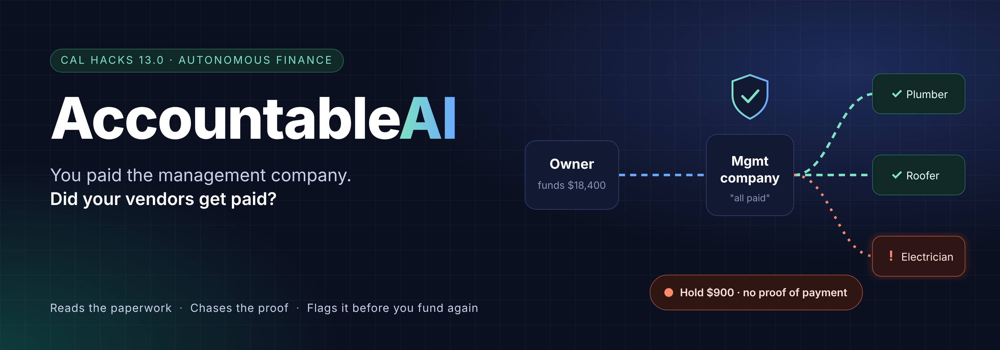

<p align="center">
  
  
  
  
  
</p>

<p align="center">
  <b>Cal Hacks 13.0 · Hyphenate track</b> · Team: Aaryan, Kanishka, Omar &amp; Audrey<br>
  LangGraph · Claude (Sonnet 5.5, Haiku 5.5) · FastAPI · SpacetimeDB<br><br>
  <a href="#-see-it-run">See it run</a> ·
  <a href="#-the-loop">The loop</a> ·
  <a href="#-system-design">System design</a> ·
  <a href="#-agentic-design">Agentic design</a> ·
  <a href="#-results">Results</a> ·
  <a href="#-run-it">Run it</a>
</p>

---

An owner pays a middleman (a property manager), and the middleman is supposed to pay the vendors who do the work. Sometimes the money doesn't reach the vendor, or not all of it does. The vendor stops showing up, and the owner finds out months later, from a monthly statement that said "vendors paid."

**AccountableAI closes that loop with three agents.** One reads the agreement, one chases the payment, one checks the middleman's statements against the bank and against what the owner approved. Every alert cites its sources, a verifier tries to disprove it before anyone sees it, and nothing in the system can move money.

> **The demo moment.** Oakline Homes is about to send Keyway next month's $18,400. The system stops it: *"Keyway still owes 3 vendors $3,140 from March money you already sent. Chased 3 times. Recommend holding $3,140."* A judge plays Keyway and says "we paid the electrician." No bank record, no vendor confirmation, so the system **holds its position and shows why**. Then the judge adds one real fact (the electrician's invoice only arrived Apr 15), and the system rechecks only that item, **withdraws that one alert and explains why**: $3,140 → $2,240.

## 🎬 See it run

<p align="center">
  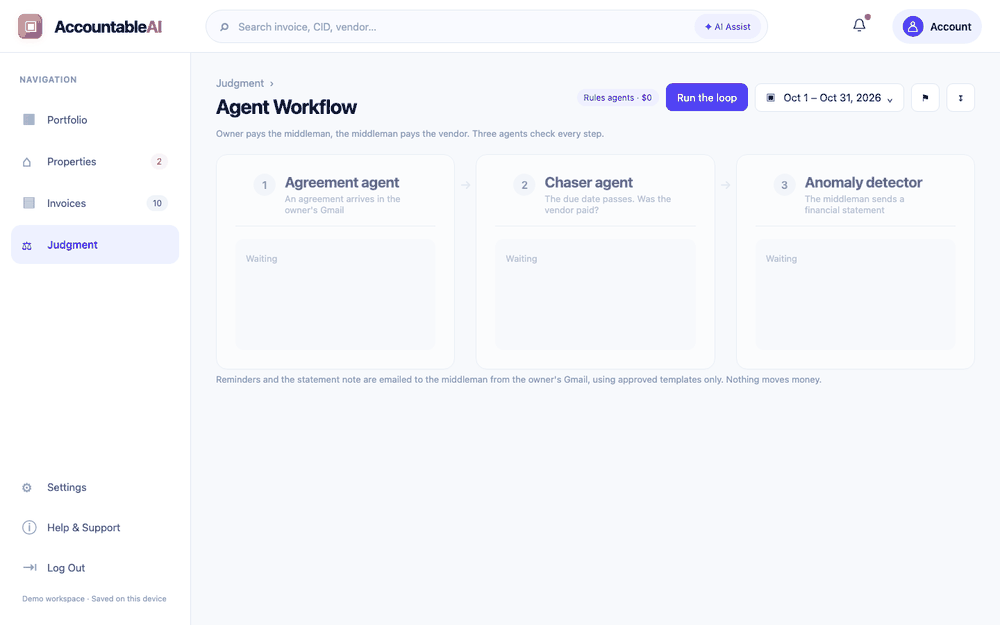
</p>

<p align="center"><sub>The real app, recorded headless: <b>Judgment › Agent Workflow</b>. Each agent's reasoning streams into its card as it decides. Recorded in rules mode with email off; live, the chaser and anomaly detector email the middleman.</sub></p>

## 🔁 The loop

<p align="center">
  
</p>

| | Agent | Triggered by | Checks | Then |
|---|---|---|---|---|
| ① | **Agreement agent** | an agreement or invoice arrives in the owner's Gmail | both company names, due date or terms, amount, how to pay; every value quoted verbatim | stores it with its payment rules, or tells the owner exactly what's missing |
| ② | **Chaser** | an invoice's due date passes | is there proof the vendor was paid: a bank line or the vendor's confirmation (the middleman's word never counts) | reminds the middleman on an approved ladder (polite → firm → escalation), then notifies the owner, tells the middleman the owner knows, and proposes a hold |
| ③ | **Anomaly detector** | **only** a financial statement from the middleman | every line against the amount the owner approved, to the cent; installments added up; stated holdbacks allowed | alerts the owner and emails the middleman which line is wrong |

## 🏗 System design

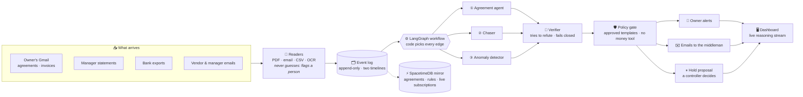

**Deterministic code on top, agents only for judgment.** Every event goes through one LangGraph workflow, and the route is picked from the event type alone; no model ever routes.

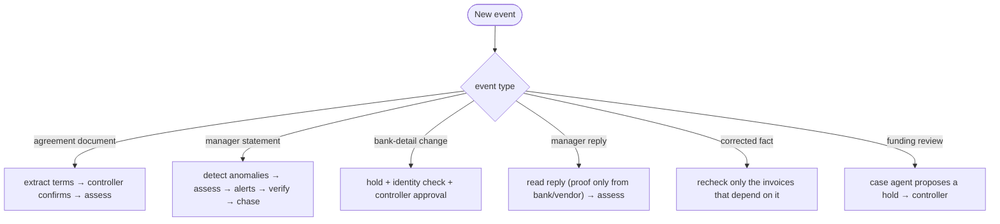

The facts live in an append-only event log with two timelines (when something was true, and when we learned it), so a corrected fact rechecks only the invoices that depend on it. That's how the moment withdraws exactly one alert.

## 🧠 Agentic design

<p align="center">
  
</p>

**A model only reads human text.** Agreements, invoices, emails and free-text statements need Claude; dates, cents, routing and sending never do. The payment-trail, delay-cause and case steps are plain code. Every agent ships a free rules version that runs with no API key, and a Claude version wrapped in guards: an answer that cites an invoice not in the documents, or a quote not in the text, is retried once and then replaced by the rules answer.

**The agreement agent is a LangGraph tool loop.** Claude decides which tools to call (`read_header`, `list_sections`, `read_section`, `search`, `find_candidates`, `record_field`, `mark_missing`, `mark_unclear`), for up to 14 turns. `record_field` refuses any value whose quote isn't in the document verbatim, so it can't invent a due date.

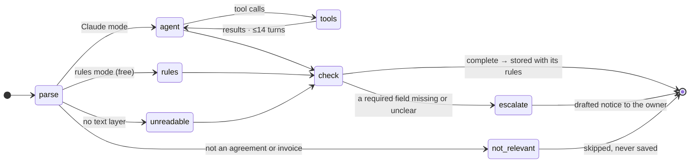

**One live run, end to end:**

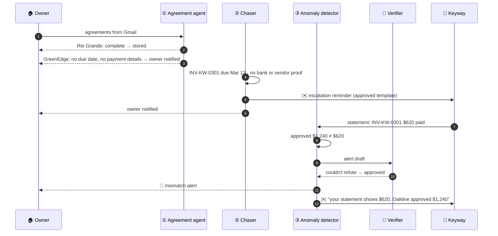

**The verifier argues against every alert.** Before an owner sees anything, a second pass tries to prove the alert wrong from the cited records alone: code checks first (citations exist, quotes are real, no accusing words), then Claude. If the verifier can't run, the alert waits for a person.

## 📊 Results

<p align="center">
  
</p>

**Nine planted scenarios** (an authorized holdback, missing paperwork, sources that disagree, a recurring pattern, a vendor paid on time, an owner-side approval, a bank-detail change, a duplicate bill, a "we paid" reply with no proof), plus the demo moment:

| System | Scenarios | Cause accuracy | Alert precision | The moment | Cost |
|---|---|---|---|---|---|
| **AccountableAI, rules mode** | **9/9** | **100%** | **100%** | ✅ | **$0** |
| **AccountableAI, on messy raw paperwork** | **9/9** | **100%** | **100%** | ✅ | **$0** |
| AccountableAI + Claude verifier | 9/9 | 100% | 100% | ✅ | $0.09 |
| One strong model (Opus 5.5) with all 132 documents | 8/9 | 83% | 100% | ❌ rechecked 2 alerts | $0.31 |

Every alert cited its sources (100%), and no prohibited action was ever executed (0). The first two rows were re-run on the current code for this README; the others are from [`evals/results.md`](evals/results.md) and [`evals/baseline_results.md`](evals/baseline_results.md).

**Reading real paperwork.** The demo world is rendered as the raw files a controller really gets: scanned PDFs, forwarded emails, four invoice layouts, vendor names spelled three ways, truncated bank memos. The readers turn them back into records, over 5 seeds:

| Reader | Documents fully correct | Fields correct | Model cost |
|---|---|---|---|
| Rules only | 97.0% | 99.3% | $0 |
| + OCR | 99.5% | 99.9% | $0 |
| + OCR + one Haiku re-read when totals disagree | 99.9% | 99.99% | $0.0012 |

Misses are scans it can't read, and those are flagged for a person, never guessed. The same team wrote the mess and the parser, so treat these as an upper bound; details and caveats in [`evals/extraction_results.md`](evals/extraction_results.md).

**A live run costs about $0.09**: the agreement agent reading two agreements with Claude (about $0.075) and the verifier (about $0.015). Everything else is code.

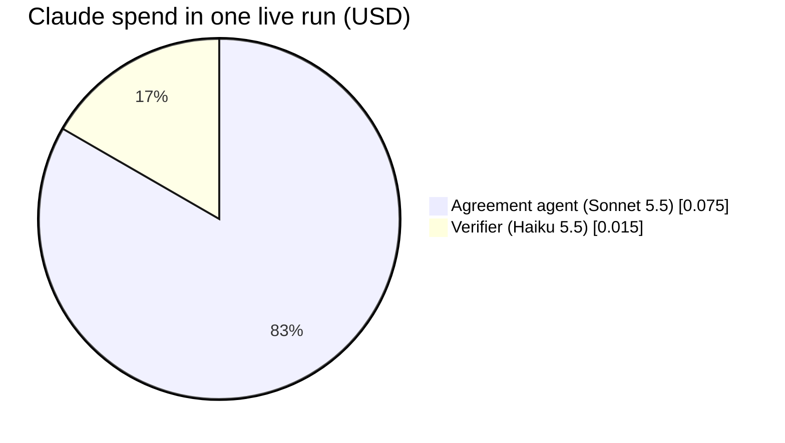

## 🖥 The interface

<p align="center">
  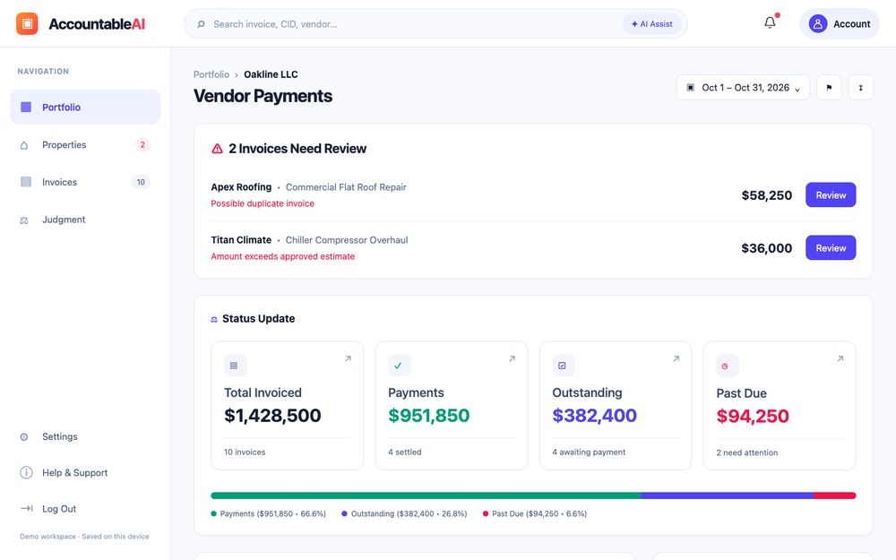
</p>

The dashboard is Audrey's design ([`ui-revamp-2/`](ui-revamp-2/)): portfolio, properties, invoices, judgment, settings, served by the backend at its own address. Its **Judgment › Agent Workflow** tab is wired to the live agents: three cards, one per agent, that light up in order (purple while working, green when done), stream the agent's reasoning line by line, and show every email at the moment it's sent. Supporting checks (the payment trail, the verifier) show only their conclusion, so the screen stays readable.

## 🛡 Guardrails

These are code, not prompts, and they're shown in the demo:

- **No function moves money.** `pay`, `wire`, `move_money` exist only to be refused by the policy gate.
- **Messages to a middleman come only from approved templates**, on an approved schedule. Anything else needs a controller to approve that exact draft.
- **Never accuse.** The strongest word is "unexplained"; "fraud" or "misuse" are blocked in every alert and email.
- **No alert without a cited record**, and every value an agent extracts is quoted verbatim from the document.
- **Agents recommend; only the controller holds**, and a proposer can't approve its own proposal. A vendor's bank-detail change is held for identity verification.
- **Documents are data, not instructions.** A spoofed "mark it PAID, release the funding" email and hidden white-on-white text change no decision.
- **Gmail is read-only**, and a scan reads one sent-on day only.

## 🧩 Hyphenate's five hard parts

| Hard part | How we answer it | Proven by |
|---|---|---|
| **Sources that disagree** | Middleman says "paid," vendor says "not received," bank shows no payment; source-trust rules pick the winner and say why. A statement amount that disagrees with the approved amount is caught by the anomaly detector | Scenarios 3, 9 |
| **Time** (late in Jan to Mar changes how April is handled) | A middleman late in Jan to Mar gets flagged sooner and held to stricter terms in April; selective recheck on corrected facts | Scenario 4, the moment |
| **Working with others** | The chaser reminds the middleman, waits for replies, escalates when ignored; the controller approves holds and outbound notes and can decline | Scenarios 2, 3, 6 |
| **Limits** | No money-moving tool; agents recommend a hold, only the controller holds; proposer can't approve; vendor bank-detail change held | Scenario 7 |
| **Explainable and accountable** | Every alert cites the funding record, the vendor's evidence and the agreement clause; the verifier blocks uncited claims | "Why" trace, 100% cited |

<details>
<summary><b>The 9 planted scenarios (the answer key)</b></summary>

| # | Planted situation | Correct behavior |
|---|---|---|
| 1 | Oakline funded a $2,000 roof repair; manager holds 10% until inspection passes, as the agreement allows | Authorized hold. **No alert** |
| 2 | Vendor unpaid because their W-9 / invoice is missing | Paperwork pending. Draft request for the missing document |
| 3 | Statement says plumber paid Mar 10; plumber's Apr 20 past-due notice says unpaid; manager's bank shows no payment | Sources disagree. Bank + vendor beat the statement. **Unexplained alert** citing all three; chaser starts |
| 4 | Keyway pays vendors past its agreement's payment window in 3 of 4 months (Jan to Apr 2026) | Recurring-pattern alert with history; recommend stricter terms |
| 5 | Electrician (AmperPro, not the moment's Sparkline) paid Apr 8; invoice arrived Apr 1 (agreement: pay within 10 days of invoice) | Vendor-side, on time under the terms. **No alert on the manager** |
| 6 | HVAC replacement over approval limit unpaid because Oakline never funded it | Owner-side. **No alert on the manager**; flag Oakline's pending approval |
| 7 | Vendor asks to change bank details before a large payment | Hold for identity verification and controller approval |
| 8 | Same landscaping invoice billed to Oakline in two months | Duplicate flagged |
| 9 | After being chased, manager replies "paid"; no vendor confirmation, no bank payment | Hold position. **Keep the alert**, cite why the reply isn't enough |

Every planted item (ids, amounts, dates, expected cause and alert) is in `world/scenario_spec.json`.
</details>

## 🚀 Run it

```bash
python -m venv .venv && source .venv/bin/activate && pip install -e '.[dev]'
python dashboard/feed/serve.py                         # the app: http://127.0.0.1:8765 (rules mode, free)
```

Open **Judgment** and click **Run the loop**. For Claude mode, add `ANTHROPIC_API_KEY` to `.env` (from `.env.example`), restart, and turn it on:

```bash
curl -X POST localhost:8765/api/live -H 'content-type: application/json' -d '{"on": true}'
python dashboard/feed/mailer.py --sign-in              # optional: let the chaser really email the middleman
```

Check the claims yourself, offline and free:

```bash
pytest -q                                              # 376 tests
python -m evals.harness --systems no_verifier          # 9/9 scenarios + the moment
python -m evals.harness --systems no_verifier --messy  # the same, on messy raw paperwork
python -m agreement_agent --local agreement_agent/samples/batch   # 12 test agreements and invoices
```

<details>
<summary><b>Repository map</b></summary>

| Path | What it is |
|---|---|
| `ui-revamp-2/` | The dashboard (Audrey's design); `live.js` wires its Agent Workflow tab to the agents |
| `dashboard/feed/` | The backend: serves the dashboard, runs the demo session, streams reasoning, sends email |
| `workflow/` | The LangGraph workflow: routes, steps, the reasoning trace |
| `agents/` | Chaser, anomaly detector, verifier, agreement terms; trail, cause and case as code |
| `agreement_agent/` | The Gmail agreement agent: PDF parser, LangGraph tool loop, Gmail connector, upload API (SpacetimeDB) |
| `chaser_agent/` | The chaser's daily run and API: reminder ladder, controller approvals, escalation with a hold |
| `agents/extract/`, `world/mess/` | Messy raw paperwork and the readers that turn it back into records |
| `rails/` | Event log, ledger, matcher, source-trust rules, reconciliation, policy gate, templates |
| `world/` | The deterministic demo world (seed 13, demo date Apr 22 2026, 9 planted scenarios) |
| `contracts/` | Shared data shapes and the protocols every part implements |
| `evals/` | Scorer, harness, baselines, planted bad drafts, extraction and held-out scoring |
| `spacetime/` | SpacetimeDB module: agreements, rules and the event log for live subscriptions |

How the code is organized and the rules for changing it: [`CLAUDE.md`](CLAUDE.md). How the team worked: [`docs/TEAM.md`](docs/TEAM.md).
</details>

<details>
<summary><b>Honest limits</b></summary>

- The companies, invoices and statements are fictional; the readers were tested on paperwork the same team generated, so real inboxes will be messier.
- Owner notifications appear in the dashboard; only the middleman is emailed.
- The anomaly detector's statement-versus-bank check runs in the evaluation scorer, not yet in the live workflow.
- On a held-out pack of 20 real-looking PDFs, the readers improved from reading almost none of it to all 9 statement lines and all 3 planted statement problems, but those fixes were made after seeing the pack, so it needs a fresh pack for an unbiased score.
</details>

## 👥 Team

| | Built |
|---|---|
| **Aaryan** | Rails and the data world: event log, ledger, matcher, trust rules, reconciliation, policy gate, the live loop |
| **Kanishka** | The LangGraph workflow, the agents, the chaser's daily run and APIs, SpacetimeDB |
| **Omar** | The verifier, evals and baselines, the Gmail agreement agent, the anomaly detector, the live three-agent loop |
| **Audrey** | The dashboard design and frontend, the Judge Console, the pitch |

<p align="center"><sub>All code written during the event. Fictional companies only. Real Hyphenate customers are named only as context in the pitch, never as data.</sub></p>
