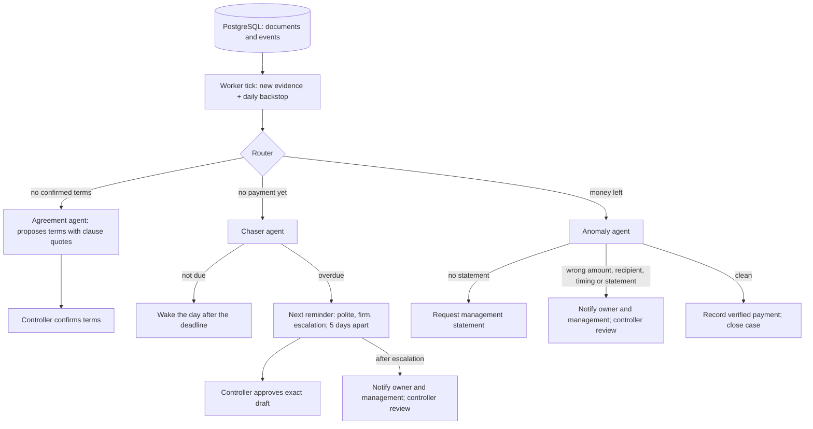

# Autonomous runtime: three agents

Three parties: the owner (Oakline), the management company (Keyway) and the vendors.
Keyway pays vendors with money Oakline funds. Three agents watch that money.



## The agents

| Agent | Code decides | Claude does |
|---|---|---|
| **Agreement** (`agents/agreement`) | Clause exists, quote is verbatim, value is in the quote | Reads unusual wording into the five terms |
| **Chaser** (`agents/chaser/daily.py`) | Due date from the confirmed terms, reminder level, 5-day spacing, when to hand off or escalate | Reads manager replies; "paid" counts only with bank proof |
| **Anomaly** (`agents/anomaly`) | Every finding: `wrong_vendor`, `recipient_unknown`, `underpayment`, `overpayment`, `late_payment`, `statement_mismatch`, holdback and terms blockers | Writes the note to the controller; it must name every finding or the template note is used |

The router (`workflow/autonomy.py`) is code. Payment proof (`workflow/evidence.py`) comes only
from dated, positive bank rows naming the invoice's vendor.

## Triggers

- A new or changed document for an invoice schedules a job (evidence fingerprint).
- A daily backstop job runs for every open case, so deadlines passing are noticed.
- Agents schedule their own next wake: the day after a deadline, tomorrow while chasing,
  three days after a statement request.
- A controller decision schedules an immediate wake.

## Human control

Nothing is sent. Reminders and statement requests are exact drafts a controller approves;
approved drafts go to the outbox, which has no real transport. Escalations notify the owner and
management on the internal case feed and open a `case_review` bound to the exact payment proof.
A controller acknowledgment of that proof lets an anomalous case close. The requester can
never approve its own draft.

## Run

```sh
RAILS=real python -m workflow.monitor --autonomous --clock wall --interval 30
```

`--once` runs one tick; `--clock world` uses the seeded demo date. Set `ANTHROPIC_API_KEY` and
`AGENTS_LLM=on` for Claude; without them the agents use their code paths.

## Code checks (not agents)

The event-by-event workflow (`workflow/graph.py`) still uses plain code for the payment trail,
delay cause, hold arithmetic, alert wording and the briefing: `workflow/checks/`.

## Tests

`workflow/tests/test_three_agents.py` covers the reminder ladder, spacing, declined drafts, not-due
sleeping, paid replies without proof, statement requests, each anomaly, escalation dedupe,
controller acknowledgment, Claude's note and its fallback, and restart idempotency.
