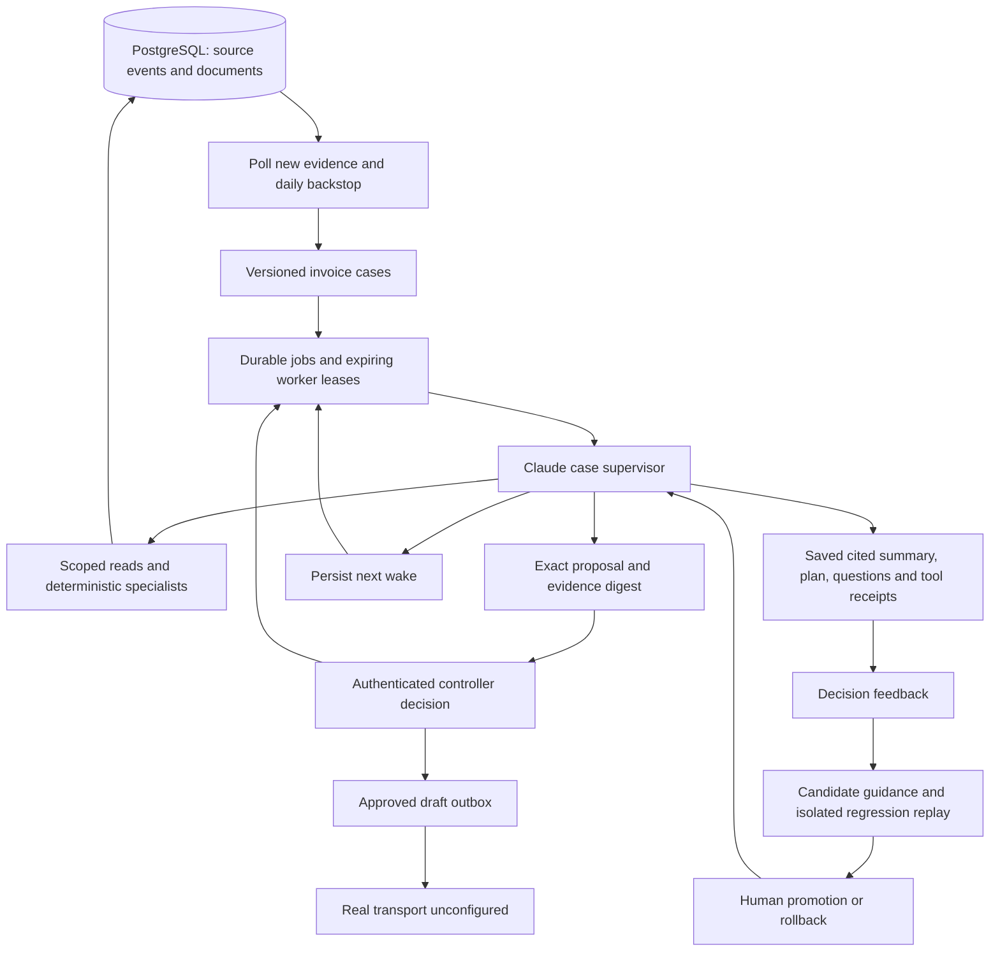

# Autonomous finance runtime

Implementation branch: `codex/vendor-chaser`, based on `kani/workflow` at `a44def1`.
Workspace: `/Users/j_kanishkha/.codex/worktrees/vendor-chaser/RepoCalhacks13.0`.

The case supervisor chooses native tools to investigate each invoice. Deterministic services
control payment math, recipient identity, agreement applicability, deadlines, resolution,
job ownership, and approval validity. The model cannot execute arbitrary SQL, approve its own
proposals, change bank details, or move money.



## Start and inspect

1. Start PostgreSQL and set `RAILS=real`, `MEMORY=postgres`, `ANTHROPIC_API_KEY`, and
   `AGENT_MODEL` in the project environment. `AGENT_MODEL` defaults to `claude-sonnet-5-5`.
   Set a long random `CONTROLLER_API_TOKEN` in the environment of the API process.
   The control API returns 503 until its token is configured; it never trusts a role from a request body.
2. From the implementation workspace, start the worker:
   ```sh
   python -m workflow.monitor --autonomous --clock wall --interval 30
   ```
   `--once` runs one poll. `--clock world` uses the seeded demonstration date. World time does
   not advance by waiting; use wall time for real daily checks. Keep the legacy worker stopped
   when running this mode. Each tick handles at most 20 jobs and each investigation at most 8 tools.
   Worker leases expire after 600seconds; case locks serialize concurrent investigations.
3. Start `python dashboard/feed/serve.py` and `npm --prefix dashboard run dev` from this
   workspace. Open `/autonomy` using the sidebar and enter the same controller token.
   This page reads PostgreSQL, independently of the older in-memory demonstration session.
   Refresh explicitly to see new state. The token stays in React memory, not browser storage.

The existing Python virtual environment may be used by its absolute path:
`/Users/j_kanishkha/CALHACKS/RepoCalhacks13.0/.venv/bin/python`.
Install the dashboard's locked dependencies in this worktree before running it independently.
No persistent worker is installed or started by these code changes.

## Agreements and triggers

Gmail and Outlook intake are excluded. Agreements already present as source documents are
parsed by the existing guarded agreement agent. New supported agreements become durable
`agreement_terms` proposals on an invoice case; an authenticated controller must approve
before a `terms_confirmed` record becomes binding. Clause quotes, complete conditions, fee
allowances, effective dates, vendor scope, and calendar/business-day semantics are retained.
Business days currently exclude weekends; holiday calendars and unsupported triggers require
review. Intake can create an agreement review case before the first invoice arrives.
Existing manual/source ingestion remains available through the project's existing interfaces.

Changes in case-scoped documents or confirmed terms schedule a job. A daily backstop handles
elapsed deadlines even when no row changes. The supervisor may additionally schedule a future
wake. Human decisions enqueue another wake. Process restarts recover cases, jobs, approvals,
outbox and memory from PostgreSQL. Resolved cases reopen when business evidence changes.

Pending requests are deduplicated while their exact payload and evidence remain current.
Payment claims do not prove payment. Dated positive bank evidence must identify the vendor;
wrong recipients, missing identities, amounts and deadlines are checked deterministically.
Supporting statements must reconcile with the bank evidence. Human acknowledgments bind the
current proof fingerprint and cannot waive missing terms or incomplete holdback conditions.

## Human control and delivery

All `/api/autonomy/*` endpoints require `Authorization: Bearer <controller token>`. The local
controller identity is server-defined as `controller.dana`; this is a single-controller local
control plane, not a multi-user identity provider. Production SSO/roles remain deployment work.

Approval binds the exact recipient, body, kind, and business-evidence digest; incidental agent
plan edits do not invalidate it. Evidence changes and expiry prevent new execution. Stale
pending proposals can still be rejected. One approved message ticket can queue only one message.
Approvals, rejections and internal owner/management notifications are audit records.

Real delivery is unconfigured. `queued`/`waiting_transport` do not mean sent. The only provided
transport is `TestTransport`, which explicitly returns `delivered_test`. No email or money is
sent by this implementation. Future real delivery needs a provider with durable idempotency
and receipt recovery; never substitute an untracked send call.

## Context, memory and reviewed learning

- `agent_cases`: current state, cited summary, plan, open questions, next action/wake, revision.
- `scheduled_jobs`: durable due times, leases, attempts and retry state.
- Event log: source facts, confirmations, case changes, every native tool request/result,
  model/token receipts, context/skill hashes, approvals, outbox snapshots and feedback history.
- `agents/skills/`: reviewed investigation, agreement, chasing, payment-review and escalation
  guidance. Tool capabilities are defined in Python and cannot be added by guidance text.
- Context reconstruction compacts current memory and recent observations within 16k characters;
  complete history remains in PostgreSQL and is available through scoped tools and the case feed.
  Hidden chain-of-thought is not stored; explicit decisions, actions and evidence are stored.

Feedback must reference an existing decision in the selected case. Candidate guidance is
versioned and hashed. Promotion requires a measured isolated replay evaluation of runtime
safety invariants, an unchanged evaluation case revision, and an authenticated human decision.
All five supported skill overlays load on the next investigation; rollback restores the prior
version. This is reviewed guidance learning, not automatic model-weight training. The built-in
replay uses scripted native tool responses to test safety guards and context integration; it
**does not establish improved live-model semantic quality**. Compare actual model outcomes on
an accepted business evaluation set before treating a guidance change as a quality improvement.

## Code map

| Responsibility | Files |
|---|---|
| Trigger worker and ownership | `workflow/monitor.py`, `workflow/autonomy.py` |
| Case projection and durable jobs | `workflow/cases.py`, `workflow/scheduler.py`, `rails/cases/schema.sql` |
| Native supervisor and tools | `agents/supervisor/__init__.py`, `agents/tools/__init__.py` |
| Context and skills | `agents/context.py`, `agents/skill_registry.py`, `agents/skills/` |
| Agreement parsing and confirmation | `agents/agreement/`, `workflow/agreement_intake.py`, `workflow/terms.py`, `rails/facts.py` |
| Payment identity and amount | `rails/guards/payments.py`, `rails/ledger/build.py`, `rails/recon/reconcile.py`, `workflow/payment_review.py` |
| Human decisions and drafts | `workflow/human.py`, `workflow/outbox.py`, `workflow/runtime_lock.py` |
| Feedback and reviewed promotion | `workflow/feedback.py` |
| API and UI | `workflow/autonomy_api.py`, `dashboard/feed/serve.py`, `dashboard/app/autonomy/page.tsx`, `dashboard/components/Shell.tsx` |

## Verification

`python -m pytest -q` includes disposable-schema PostgreSQL tests. Targeted native E2E tests
cover discovery, tool selection, human approval, exact-draft queueing, restart recovery,
evidence-triggered wakes, and completion of the resolving worker's own lease.

Live smoke: `PYTHONPATH=. python scripts/verify_autonomy.py --live`. It uses the configured
Anthropic key and a disposable PostgreSQL schema, writes `docs/AUTONOMY_LIVE_VERIFICATION.json`,
and removes the schema. Latest run made 3 successful model calls and 8 native tools:
6 scoped reads, payment analysis, and a proof request; no tool errors and no external messages.
The bound then scheduled continuation, verifying that an incomplete investigation wakes again.

Final validation checkpoint: full suite **450 passed, 2 skipped**; later focused regressions
cover agreement-before-invoice intake, case-scoped history redaction, invoice-number ambiguity,
and PostgreSQL resolution. TypeScript and the Next.js production build pass. A browser check
against an explicit test backend verified authenticated exact-proposal approval, the queued
outbox draft, and the persisted decision trace. Test servers were stopped after verification.
Python, TypeScript, and security reviews were completed; their actionable findings have
regression coverage. Development-mode browser hydration was unreliable with the shared
node_modules symlink; production-mode browser verification passed.
