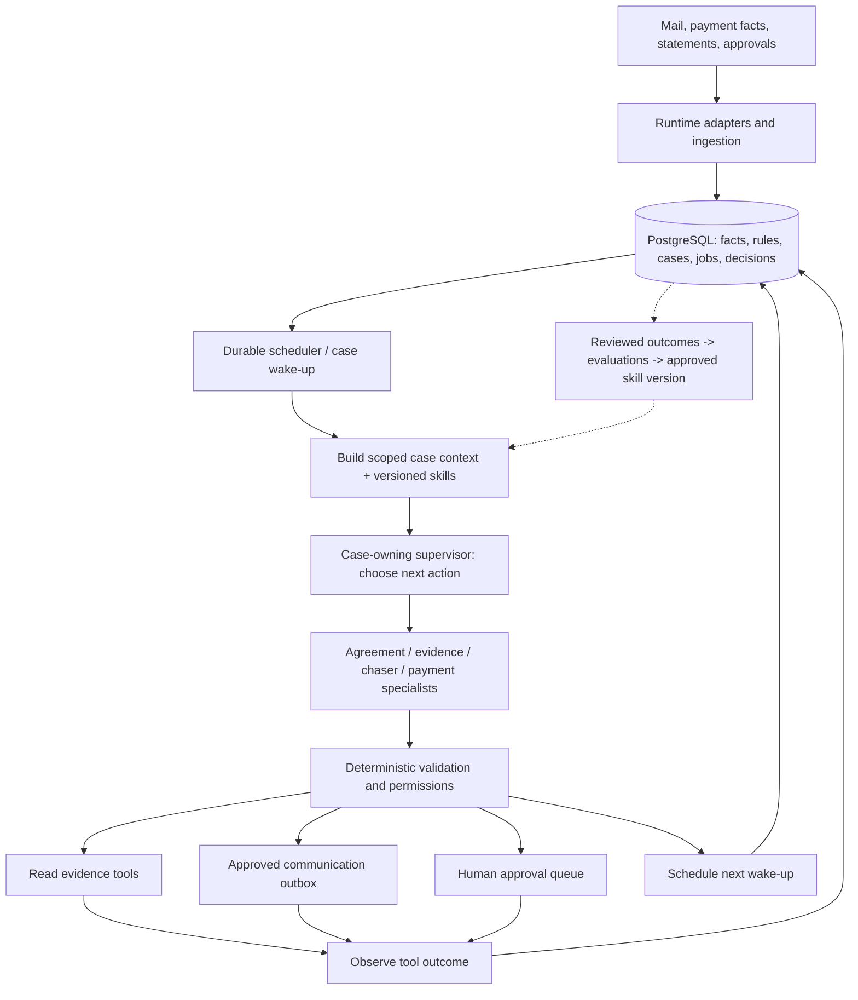

# Autonomous Vendor Accountability Roadmap

> **For agentic workers:** This is a roadmap for review, not authorization to implement every milestone. After scope is accepted, expand one milestone at a time into a task plan using superpowers:writing-plans, then use superpowers:executing-plans or the user's selected execution method. Track deliverables with the checkboxes below.

**Goal:** An agent owns a vendor-payment case from agreement intake through payment verification, supporting statements and resolution, taking permitted actions and waking itself again without repeated user prompts.

**Architecture:** One case-owning supervisor delegates agreement interpretation, evidence analysis, chasing and payment review to specialists. Claude chooses the next investigative action through typed tools; deterministic services enforce contractual calculations, access scope, state transitions, approvals and external effects. PostgreSQL stores authoritative facts, case memory, decisions, approvals and scheduled work.

**Tech Stack:** Retain Python, LangGraph, Pydantic, Anthropic, PostgreSQL and the existing Next.js dashboard. Add runtime mail adapters using configured MCP servers or service APIs; connector selection is an implementation decision. No extra database is required for the first release.

**Spec:** The user-confirmed four-stage flow and requirements below. All architectural additions in this document are proposals; the existing implementation is separately identified.

## Requirements

The confirmed business flow is:

1. Agreement agent receives an agreement from Gmail/Outlook, extracts obligations with citations, obtains required confirmation and saves rules.
2. Monitoring/chaser agent owns invoices governed by those rules, watches payment evidence, contacts management and waits for responses.
3. Payment-review agent checks recipient, amount and timing, requests supporting statements and reconciles them.
4. Escalation informs management and owner, records the outcome, and obtains human approval for consequential actions.

Required capabilities:

| ID | Requirement | Evidence that it works |
| --- | --- | --- |
| R1 | Intake source emails, threads and attachments with provenance and deduplication | Replayed message creates one source record and the correct case |
| R2 | Confirm complete, versioned, scoped contract rules | Amendment cannot silently remove a condition or change an unrelated/historical invoice |
| R3 | Own an unresolved case over time | Case retains status, plan, pending evidence, next action and wake-up time after restart |
| R4 | Choose and execute useful investigative actions | Claude selects authorized evidence tools and uses observations to select its next action |
| R5 | Continue after a reply, payment, approval, timeout or correction | Fresh input wakes the correct case without a user prompt |
| R6 | Communicate and follow through | Approved request is actually delivered; reply is correlated; silence schedules a follow-up |
| R7 | Verify payment and statements | Wrong vendor, partial/duplicate payment and unsupported paid claims cannot resolve a case |
| R8 | Apply human authority | Controller approval is authenticated, bound to the exact proposal and preserved across restart |
| R9 | Retain context and explain decisions | Every action links to retrieved facts, rule version, context/skill version and resulting observation |
| R10 | Improve from reviewed outcomes | Feedback produces evaluated, versioned improvements; financial rules never change without authority |

## Current implementation and gaps

| Area | Current state | Gap |
| --- | --- | --- |
| Database | Real PostgreSQL reads/writes; append-only source and decision events | No complete durable autonomous-case/job model |
| Agreement | Claude extraction, proposal and controller-confirmation path | Email intake missing; audited condition/version/provenance defects remain |
| Triggering | Polling worker and one scan per UTC day; real background behavior tested | Worker is stopped; jobs/checkpoints, leases and recovery need operational integration |
| Agent reasoning | Real Claude trail, cause, reply-reading, verifier and case-summary calls | Python currently chooses the steps and retrieves evidence; no case-owning tool loop |
| Chasing | Approved templates, escalation schedule and reply interpretation | Requests are internal records; no delivered-message/reply/timeout loop |
| Payment review | Deterministic amount/vendor/deadline/statement checks | Must share trustworthy contract applicability, proof and payable-amount logic |
| Human approval | Backend policies, approval events and LangGraph interruption | Default checkpoints are RAM; dashboard feed is a separate in-memory demo; new statement drafts lack a connected approval flow |
| Memory | Historical documents, decisions, reminders and rulings in PostgreSQL | No persisted per-case plan/summary/context manifest or budgeted retrieval policy |
| Runtime skills | Prompts and rules embedded in Python | No runtime SKILL.md registry, version pinning or capability mapping |
| Learning | Logs and some history-based behavior | No outcome feedback/evaluation/promotion loop |

Previous tests establish that real Claude and PostgreSQL can execute the demonstrated invoice paths. They do not establish an autonomous email-to-resolution system. See `docs/INVOICE_E2E_TRACE.md` and `docs/AGREEMENT_LOGIC_REVIEW.md`.

## Global constraints

- Three business roles: owner, management and vendor. Contract applicability must explicitly identify who owes what to whom.
- No money-moving tool. Holds, bank-detail changes and other consequential recommendations require authorized human decisions.
- An agent cannot approve its own proposal. Email text and attachments are untrusted evidence, not instructions or approval authority.
- Preserve existing source history and additive contract compatibility. Corrections create versions and superseding events.
- New facts and dependency indexing must become visible together; work claiming and completion must be durable.
- Use one PostgreSQL application database initially. A vector database and Neo4j are not prerequisites for autonomy.
- Development Codex skills do not become runtime finance-agent skills automatically.
- Exact provider credentials, mailbox ownership, allowed recipients, templates and sending authority must be configured before external delivery is enabled.
- Implementation proposals below are not actions taken by this roadmap; no mail is sent or worker started during planning.

## Target map

The supervisor owns the question “What should happen next for this case?” Deterministic code owns whether a proposed action is allowed and how authoritative values are calculated.

## Milestone 0 — Make the existing facts and controls trustworthy

**Deliverable:** A correct foundation for autonomous decisions.

- [ ] Fix the reproduced agreement defects: complete confirmed terms, explicit removals, actual conditions/charges, preserved clause citations, stale approval protection and effective-date/version selection.
- [ ] Represent calendar/business-day basis explicitly. Until the relevant calendar is configured, unsupported deadlines must await human handling rather than silently becoming calendar-day deadlines.
- [ ] Define agreement scope and precedence for owner–management and vendor-specific contracts; conflicting applicability goes to review.
- [ ] Share payment-proof and payable-amount rules across the ledger, trail, chaser, cause and payment review. Any payment row is not automatically proof of full payment to the intended vendor.
- [ ] Ensure event append and dependency indexing are atomic so a poll cannot finish an unindexed input.

**Code areas:** `agents/agreement/`, `agents/chaser/rules.py`, `agents/trail/rules.py`, `agents/cause/`, `workflow/terms.py`, `workflow/steps.py`, `workflow/payment_review.py`, `rails/facts.py`, `rails/matcher/`, `rails/ledger/`, `rails/real.py`.

**Acceptance:** Regression tests reject wrong-vendor/zero/partial proof, retain a 10% holdback only while its actual condition applies, preserve clause 4.1 rather than inventing 7.2, reject stale approval and prevent 2027 rules from rewriting a 2026 obligation.

## Milestone 1 — Durable case ownership and wake-ups

**Deliverable:** The system retains an invoice case and its pending work after a process restart.

- [ ] Add a durable `AgentCase` model, distinct from the existing `Case` approval/evidence pack. Minimum fields: business scope, invoice ID, agreement version, lifecycle state, case version, open questions, next action, `next_wake_at`, last observation and pending approval.
- [ ] Use explicit states such as `awaiting_terms`, `monitoring`, `awaiting_payment_proof`, `awaiting_statement`, `awaiting_human`, `escalated` and `resolved`; evidence changes can reopen a case.
- [ ] Add PostgreSQL-backed scheduled jobs with case ID, due time, lease owner/expiry, attempt count and idempotency key. Use atomic claiming, retry backoff and recovery of expired leases.
- [ ] Enable PostgreSQL LangGraph checkpoints. Persist wait/approval state, not just completed business events.
- [ ] Route replies, bank facts, statements, agreement corrections and human decisions to the matching case. Keep the daily scan as a repair sweep.

**Proposed files:** `workflow/cases.py`, `workflow/scheduler.py`, `rails/cases/schema.sql`, `rails/cases/store.py`; extend `workflow/state.py`, `workflow/runner.py`, `workflow/monitor.py`.

**Acceptance:** Restart while awaiting a reply and while awaiting approval. Neither loses state. Two workers cannot perform the same scheduled action. A resolved case reopens when its payment proof is retracted.

## Milestone 2 — Real intake and scoped evidence tools

**Deliverable:** The runtime can receive and retrieve the evidence it needs.

- [ ] Implement a `MailAdapter` boundary for message sync, thread retrieval and attachment retrieval. Proposed MVP: Gmail first; Outlook implements the same boundary afterwards. Both remain requirements for the complete system.
- [ ] Give the deployed runtime its own configured connector/OAuth access; do not assume it can borrow this Codex chat's connectors or authentication.
- [ ] Preserve provider/message/thread IDs, sender, recipients, received time, content hash, attachment source and extracted text. Deduplicate and correlate to owner/management/vendor/case.
- [ ] Ingest a new agreement as an unconfirmed proposal. Changes to existing obligations require the versioned confirmation flow.
- [ ] Expose typed tools such as `get_case`, `get_confirmed_terms`, `get_invoice`, `get_payment_records`, `read_thread` and `fetch_attachment`. The tool layer scopes every query and result to the case and actor.

**Proposed files:** `integrations/mail/base.py`, `integrations/mail/gmail.py`, later `integrations/mail/outlook.py`, `workflow/intake.py`, `agents/tools/read.py`.

**Acceptance:** A test-mailbox email with an agreement attachment creates one correctly scoped proposal. Replaying it creates nothing twice. A different company's records cannot be retrieved. Instructions embedded in an attachment cannot authorize a tool or bypass approval.

## Milestone 3 — The case-owning agent, context and runtime skills

**Deliverable:** Claude selects the next useful action and continues from its observations.

- [ ] Add a supervisor loop: load case -> assemble context -> select typed action -> validate -> execute -> record observation -> update case -> continue, wait or request approval.
- [ ] Delegate interpretation to existing specialists rather than making every agent run on every wake-up. Retain fixed accounting and permission checks around their outputs.
- [ ] Let the supervisor choose evidence retrieval, proof request, statement request, waiting, escalation or resolution. Bound tool iterations, model calls, elapsed time and spend per wake-up; exhaustion becomes a visible wait/error state.
- [ ] Build context from confirmed obligations, current ledger, recent case activity, pending questions and selected historical decisions. Persist a source manifest and context/skill versions for each decision.
- [ ] Store a compact per-case summary with links to original evidence. Summaries aid retrieval; authoritative facts and contract versions remain the basis for financial decisions.
- [ ] Introduce reviewed runtime `SKILL.md` files for agreement interpretation, chasing, payment review and escalation. Pin their version/hash to each decision and map them to allowed tools; Markdown alone grants no capability.

**Proposed files:** `agents/supervisor/{agent.py,models.py}`, `agents/tools/registry.py`, `agents/context.py`, `agents/skills/{agreement,chasing,payment_review,escalation}/SKILL.md`, `agents/skill_registry.py`; extend `workflow/trace.py`.

**Acceptance:** On “we paid”, the supervisor chooses to inspect proof; on missing proof it requests the missing evidence and schedules a check. On silence it follows up; on a new fact it revises its plan. These choices are observed in tool traces, not merely described in generated prose. Restart reconstructs the case context and pending action without the user restating them.

## Milestone 4 — Human decisions and actual communication

**Deliverable:** Requests are delivered and followed through under an approved operating policy.

- [ ] Define permitted recipients, approved reminder templates, cadence, escalation thresholds and which actions need exact-draft approval.
- [ ] Bind approvals to authenticated identity, exact recipient/body or proposal, case/rule version, expiry and decision. Reject self-approval, stale approval and reuse for a changed proposal.
- [ ] Add typed action tools: `draft_message`, `request_approval`, `queue_approved_message`, `schedule_wakeup`, `record_case_update` and `propose_resolution`.
- [ ] Implement a transactional message outbox, per-action idempotency and recorded delivery attempts. Correlate provider message/thread IDs with later replies; reconcile an uncertain send before retrying.
- [ ] Connect the dashboard's case queue, evidence and approval controls to the same PostgreSQL-backed service as the worker. Show what the agent is waiting for and what the human can approve or reject.

**Proposed files:** `agents/tools/actions.py`, `workflow/outbox.py`, `rails/outbox/{schema.sql,store.py}`; extend `workflow/approvals.py`, `rails/console/api.py`, `dashboard/feed/serve.py`, `dashboard/app/cases/page.tsx`.

**Acceptance:** An approved reminder reaches an authorized test recipient once. An unapproved draft cannot be delivered. A declined hold is recorded and respected. A reply wakes its case automatically. The dashboard's approval changes the same persistent case that the worker resumes.

## Milestone 5 — Close the loop and prove operational autonomy

**Deliverable:** One mailbox-to-resolution workflow runs without repeated user prompting.

- [ ] Keep bank/payment facts read-only inputs; reconcile amount, currency where provided, vendor, invoice, duplicates, timing and applicable holdbacks.
- [ ] Once valid payment proof exists, stop unpaid chasing, request/reconcile supporting statements, preserve historical exceptions and send approved owner/management updates.
- [ ] Define resolution criteria: valid payment evidence plus required supporting evidence, with unresolved anomalies retained or explicitly assigned for human handling.
- [ ] Run the persistent scheduler and worker under a supervised service. Add heartbeat, backlog/failed-tool visibility, bounded retries and recovery after interruption.
- [ ] Add a full audit view: trigger -> scoped context -> selected skill -> tool call -> observation -> decision -> approval -> external action -> result.

**Code areas:** `workflow/payment_review.py`, `workflow/monitor.py`, scheduler/outbox modules, `workflow/trace.py`, dashboard trace views, new `evals/autonomy/` scenarios.

**Acceptance scenario:** Agreement email arrives -> controller confirms -> invoice becomes overdue -> agent requests proof -> management claims paid -> agent checks evidence and holds position -> silence causes a scheduled follow-up -> valid bank proof arrives -> unpaid chasing stops -> statement is requested and received -> owner receives an approved resolution update. A process restart midway requires no repeated prompt and produces no duplicate delivery. No money moves.

**Proof must distinguish:** real provider/Claude/PostgreSQL calls, simulated bank facts, human actions, and unattended agent actions. The existing preloaded-fixture traces remain useful regression tests, not substitutes for this acceptance scenario.

## Milestone 6 — Continual improvement from reviewed outcomes

**Deliverable:** The system improves its behavior through a controlled feedback loop.

- [ ] Capture controller corrections, rejected actions, resolved disputes and actual case outcomes as structured feedback linked to source decisions and versions.
- [ ] Turn failures and corrections into replayable evaluation cases. Measure correct source selection, payment/cause correctness, false escalations, unnecessary messages, resolution completion, cost and latency.
- [ ] Generate proposed changes to retrieval, prompts or skills. Replay them against a fixed evaluation set and recent counterexamples.
- [ ] Require human review for activating a new skill/prompt policy version; retain rollback and show which version each case used.
- [ ] Treat model fine-tuning as a later decision supported by sufficient labeled outcomes. The first learning mechanism is reviewed, evaluated skill/context improvement, not automatic model-weight training.

**Proposed files:** `workflow/feedback.py`, `evals/autonomy/`, `agents/skills/` version metadata, `docs/learning-policy.md`.

**Acceptance:** A human corrects a planted error; it becomes a regression case. A candidate skill change improves that case without breaking fixed tests, requires review before activation and can be rolled back. Feedback cannot silently alter a signed agreement or grant new authority.

## Memory and storage map

| Kind | Location/proposal | Purpose |
| --- | --- | --- |
| Authoritative business facts and corrections | Existing PostgreSQL event log | Evidence and replay |
| Confirmed obligations | Versioned, cited agreement events | Applicable financial rules |
| Case state and plan | Proposed PostgreSQL `agent_cases` projection | Who/what/why the agent is waiting on |
| Scheduled work and delivery | Proposed jobs/outbox/tool-run records | Durable follow-through and deduplication |
| Decisions and context manifest | Existing decision events, extended with context/skill versions | Explain and reproduce actions |
| Runtime instructions | Reviewed, versioned repository skill files | Specialist procedure and constraints |
| Working execution | PostgreSQL LangGraph checkpoints | Resume paused steps |
| Long-term case context | Cited case summaries plus scoped historical retrieval | Continue work across months within context limits |
| Learning evidence | Feedback events and evaluation cases | Controlled improvement |

## Review focus

1. Message replay and uncertain delivery: prove one external effect; Milestones 2 and 4 own these tests.
2. New evidence during an action or restart: retain a consistent case version and recover pending work; Milestones 0, 1 and 5 own these tests.
3. Ambiguous contract scope, dates and amounts: request confirmation instead of guessing; Milestones 0 and 2 own these tests.
4. Untrusted mail content or another company's records: cannot change authority or leak into case context; Milestones 2, 3 and 4 own these tests.
5. A previously resolved case becomes wrong after correction: reopen, notify as permitted and preserve the prior rationale; Milestones 1, 5 and 6 own these tests.

## Delivery order and first release

Implement Milestones **0 -> 1 -> 2 -> 3 -> 4 -> 5** for the first autonomous release. Begin collecting feedback during Milestone 4; ship the improvement/promotion mechanism in Milestone 6 after the operating loop is proven.

For the first release, propose one owner, one management company, a limited vendor set and one mailbox provider. Preserve the full three-party scope in the data model. Add Outlook and broader contract varieties as separate, tested adapters/capabilities; do not label Gmail-only coverage as support for both providers.

Each implementation milestone must have failing-first tests, a reviewed change set, deterministic regression checks and a controlled live acceptance test where relevant. Expand the chosen milestone into file/function-level tasks only after the user accepts this roadmap.

**Next implementation target:** Milestone 0 and then the durable case runtime. Starting the current worker alone would automate the existing fixed workflow, but would not supply case ownership, real communication or tool-directed investigation.
